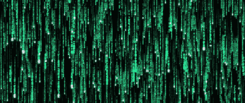
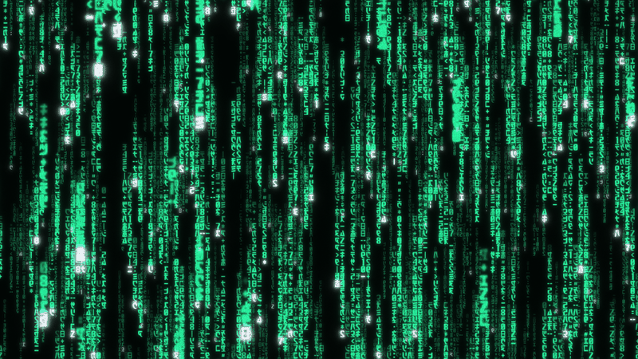
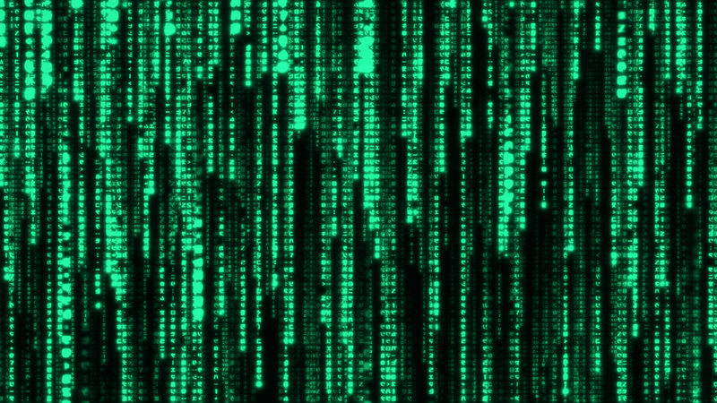
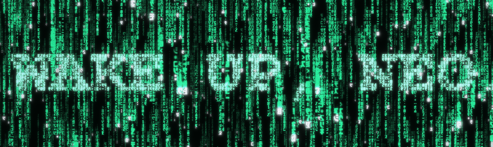

# Digital Rain

Code rain for Windows and macOS, tuned against stills from all three Matrix films.

Digital Rain is a free screensaver that recreates the falling code of The Matrix (1999), Reloaded (2003) and Resurrections (2021). Each look is measured from film frames, and every monitor you have runs its own rain. It is an unofficial fan project, not affiliated with Warner Bros.



| Download | For |
|---|---|
| [`DigitalRain-Setup.exe`](https://github.com/phabzlabs/digital-rain/releases/latest/download/DigitalRain-Setup.exe) | Windows 10 and 11 |
| [`DigitalRain.dmg`](https://github.com/phabzlabs/digital-rain/releases/latest/download/DigitalRain.dmg) | macOS 12 or later, signed ad hoc and not notarised |

> [!NOTE]
> The installer isn't code-signed and the Mac saver isn't notarised, so Windows or macOS may ask you to allow them. [Install](#install) says how.

In the screensaver picker it is listed as Digital Rain. The files and the settings folder keep the older name, `MatrixRain`. The website, with the full documentation, is at [phabzlabs.github.io/digital-rain](https://phabzlabs.github.io/digital-rain/).

## The three film looks

There is no official specification of the rain, so each look is tuned against numbers taken from film frames: colour, brightness, glyph shapes and spacing. A Custom look adds colours, scanlines and other CRT effects if you want them.

| The Matrix (1999) | Reloaded (2003) | Resurrections (2021) |
|---|---|---|
|  |  |  |
| The green leans blue, at hue 152 to 154°. The film's 57 glyphs light up one cell at a time at 24 frames per second. | Heads are mint green with no white leaders, and about 27 to 32% of the frame is lit. | The background is dark green, and 135 newer glyphs sit on square cells in three layers of depth. |

The measurements, their sources and their limits are in [Film research](https://phabzlabs.github.io/digital-rain/film-research.html).

## What else it does

<table>
<tr>
<td width="55%"></td>
<td>The rain can spell out the time or up to 24 characters of your own text. Now and then, lines from the film type themselves over it.</td>
</tr>
<tr>
<td width="55%"></td>
<td>Point it at a folder of photos and the rain forms them one after another, with a depth model keeping them in perspective. Photo: Anton Petrov, CC0.</td>
</tr>
</table>

It also fits its rain to every monitor's size and scaling, lets one monitor use a different look, can speed up as your computer gets busier, and falls back to a software renderer where OpenGL isn't available. The settings window has a live preview, and nothing is saved until you press OK. [Every feature](https://phabzlabs.github.io/digital-rain/features.html) and [every setting](https://phabzlabs.github.io/digital-rain/settings-reference.html) are in the documentation.

## Install

On Windows, run `DigitalRain-Setup.exe`. It installs for your user only, without administrator rights, then offers to set Digital Rain as your screensaver. The installer isn't code-signed, so if SmartScreen says it protected your PC, click **More info** and then **Run anyway**.

On a Mac (macOS 12 or later), open `DigitalRain.dmg` and double-click `Digital Rain.saver`. It's signed ad hoc and not notarised, so if Gatekeeper blocks it, click **Open Anyway** in **System Settings > Privacy & Security**. To update, install a newer `DigitalRain.dmg` the same way, then run `killall legacyScreenSaver` in Terminal or log out and back in.

<details>
<summary>Check your download</summary>

Each release has a `SHA256SUMS.txt` and a signed build provenance attestation for each file.

```powershell
Get-FileHash DigitalRain-Setup.exe -Algorithm SHA256   # compare with SHA256SUMS.txt
```

```bash
shasum -a 256 -c SHA256SUMS.txt --ignore-missing      # macOS or Linux
gh attestation verify DigitalRain-Setup.exe -R phabzlabs/digital-rain
```

</details>

Updating, uninstalling, multiple monitors and troubleshooting are covered in [Installing and uninstalling](https://phabzlabs.github.io/digital-rain/installing-and-uninstalling.html).

## Build from source

On Windows you need Python 3.14.

```powershell
git clone https://github.com/phabzlabs/digital-rain.git
cd digital-rain
python -m pip install -r requirements/requirements.txt
python matrix_saver.py /s
```

`/c` opens the settings window instead. `.\build.ps1` builds the installer. [Build and release](https://phabzlabs.github.io/digital-rain/build-and-release.html) has the details.

On a Mac, install Python 3.14 from python.org, clone the repository the same way, then build and install the saver:

```bash
bash tools/build/build_mac.sh --install
```

[macOS](https://phabzlabs.github.io/digital-rain/macos.html#build) has the details.

## Documentation

- To use it, read [Features](https://phabzlabs.github.io/digital-rain/features.html), [Settings reference](https://phabzlabs.github.io/digital-rain/settings-reference.html), [Installing and uninstalling](https://phabzlabs.github.io/digital-rain/installing-and-uninstalling.html) and [macOS](https://phabzlabs.github.io/digital-rain/macos.html).
- To see how it works, read [Architecture](https://phabzlabs.github.io/digital-rain/architecture.html), [Rendering pipeline](https://phabzlabs.github.io/digital-rain/rendering-pipeline.html), [Design decisions](https://phabzlabs.github.io/digital-rain/design-decisions.html) and [Platform and monitors](https://phabzlabs.github.io/digital-rain/platform-and-monitors.html).
- To work on it, read [Contributing](https://phabzlabs.github.io/digital-rain/contributing.html), [Build and release](https://phabzlabs.github.io/digital-rain/build-and-release.html), [Checks and tests](https://phabzlabs.github.io/digital-rain/checks-and-tests.html), [Film research](https://phabzlabs.github.io/digital-rain/film-research.html) and [Licensing and credits](https://phabzlabs.github.io/digital-rain/licensing-and-credits.html).

The pages are built from the Markdown in [`wiki/`](wiki/), so a change to the documentation is a pull request like any other. Changes between releases are in [CHANGELOG.md](CHANGELOG.md).

## Contributing

Bug reports, ideas and pull requests are welcome. [CONTRIBUTING.md](CONTRIBUTING.md) explains the set-up and the checks to run. Please follow the [code of conduct](CODE_OF_CONDUCT.md), and report security problems privately as [SECURITY.md](SECURITY.md) describes.

## Licence and credits

Copyright (C) 2026 madkoding and phabzlabs contributors. Digital Rain is free software under the [GNU General Public License v3.0](LICENSE). Third-party components keep their own licences, listed in [THIRD_PARTY_NOTICES.md](THIRD_PARTY_NOTICES.md).

- It started from [madkoding/matrix-screensaver](https://github.com/madkoding/matrix-screensaver) (GPL-3.0), the original Windows screensaver.
- The glyph atlases, the Matrix Code font and the glyph order come from [Rezmason's matrix](https://github.com/Rezmason/matrix) (MIT), whose reconstruction of the rain also guided the film looks.
- Carl Newton's frame-by-frame analysis of the 1999 opening informed the research. None of it is bundled.
- Pictures use Depth Anything V2 Small (Apache-2.0): the ONNX export from onnx-community on Windows, run with ONNX Runtime (MIT), and Apple's Core ML conversion on macOS.
- Optional upscaling is based on AMD FidelityFX Super Resolution 1.0 (MIT).

*The Matrix* and its digital rain are the property of Warner Bros. Digital Rain is a Matrix-inspired fan project, not affiliated with or endorsed by them.
