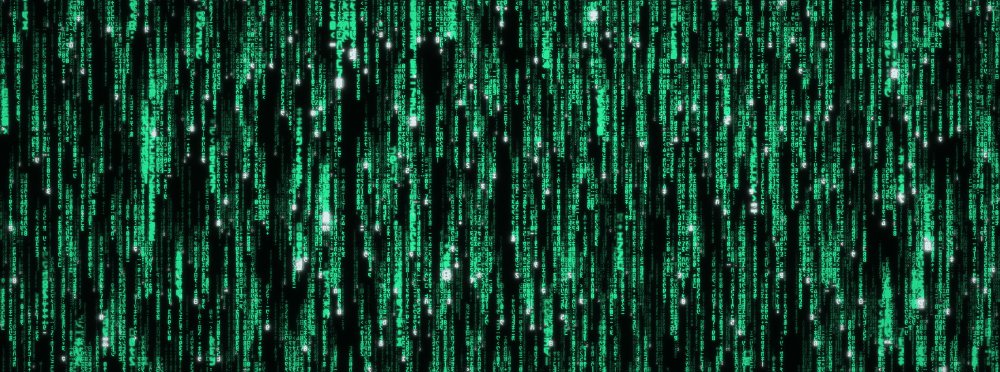
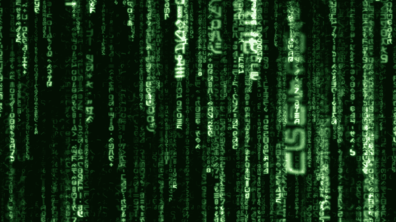
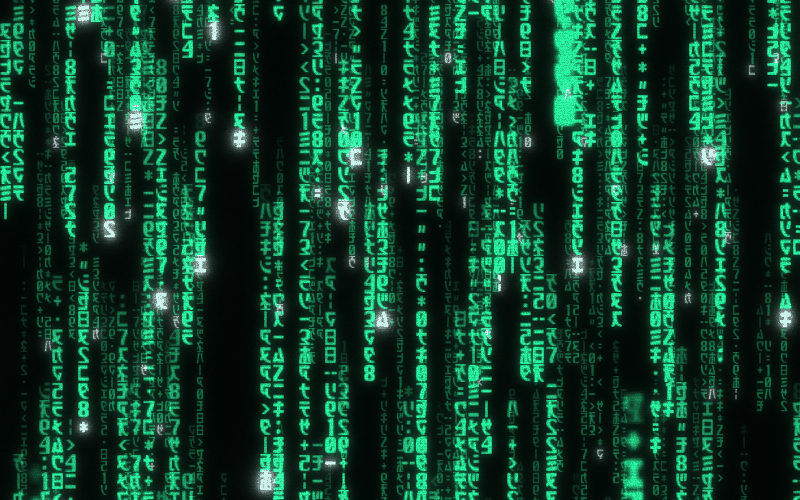
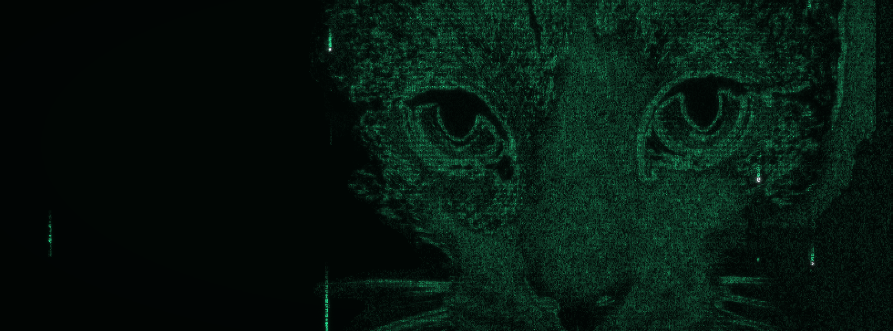
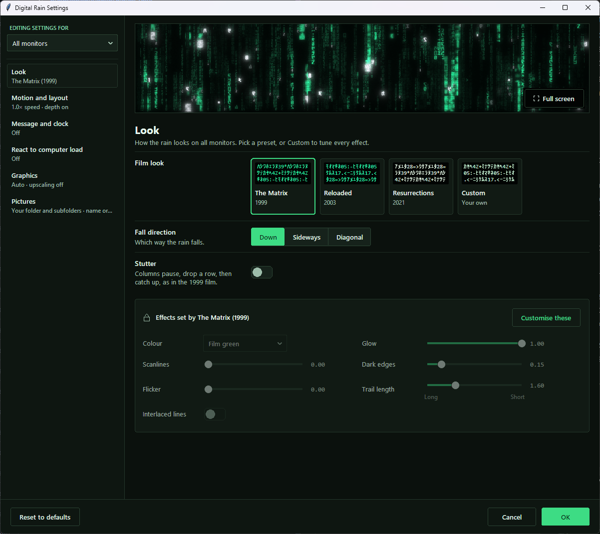

# Digital Rain

A Matrix-inspired digital rain screensaver for Windows and macOS. It shows as **Digital Rain** in the screensaver picker; the files and the settings folder keep the name `MatrixRain`.

Written in Python: GPU-rendered, multi-monitor, DPI-aware and configurable. It runs on Windows 10 and 11 and on macOS.

**Website and install guide:** https://phabzlabs.github.io/digital-rain/


*An 8-second loop of the default look, The Matrix (1999), rendered at 2560 x 1080 and scaled down.*



*The default look, The Matrix (1999), captured from the saver on one 3440 x 1440 ultrawide monitor.*

| The Matrix (1999) | Reloaded (2003) | Resurrections (2021) |
|---|---|---|
|  |  |  |

| Close-up | Message in the rain | Picture in the rain |
|---|---|---|
|  |  |  |

*The three film looks, a close-up at full resolution, the text "Wake up, Neo..." forming out of the rain (set Message to Your text on the Message and clock page), and a cat portrait formed by the rain in the Over the rain style. The photo is "Cat portrait" by Anton Petrov, CC0, from Wikimedia Commons.*

## Features

- The whole rain is computed in an OpenGL fragment shader. A software renderer takes over when OpenGL isn't available (Remote Desktop, some VMs).
- Every display runs its own rain, fitted to its resolution, position and Windows scaling. Plugging or unplugging a display while it runs is picked up.
- Three film looks, The Matrix (1999), Reloaded (2003) and Resurrections (2021), measured against film stills, plus Custom, which lets you tune every effect. The rain can fall down, sideways or diagonally, and the 1999 look can stutter as in the film.
- The film's own 57 glyphs (blocky katakana, digits and symbols, with the film's selective mirroring) come from the bundled Matrix-Code.ttf by Rezmason. If that file is missing, MS Gothic and Courier New Bold stand in with the same selection and mirroring.
- The leading glyph is almost white, the trail fades through phosphor green, and glyphs mutate at random.
- Three parallax layers give depth: a dim, slow far layer, a middle layer and a large out-of-focus near layer.
- Bloom is a multi-scale blur of the whole frame, not a halo per glyph.
- Scanlines with animated interlacing (even and odd fields alternate every frame), a vignette and a subtle flicker give a CRT look.
- Now and then *"Wake up, Neo..."* and other lines from the film type themselves out over the rain.
- The rain can spell out the time or your own text, every 36 seconds or with the clock kept on screen.
- Pictures from a folder of yours, formed by the rain one after another (GPU renderer, film looks falling down).
- The rain can speed up or thicken with the computer's CPU or GPU load.
- Colours for Custom: `film`, `classic`, `amber`, `red`, `blue`, `white`.
- A settings window with a live preview and per-monitor overrides, and the live preview in the Windows screensaver picker.
- HDR output on HDR displays: the brightest characters go above SDR white (GPU renderer).
- Optional AMD FSR 1.0 upscaling renders at 67%, 59% or 50% of the resolution per axis and upscales with a GLSL port of AMD's EASU + RCAS (off by default). The rain is a cheap shader, so on a fast GPU FSR costs more than it saves; it is meant for weak or integrated GPUs and very high resolutions. Scanlines, interlacing and flicker are applied after upscaling so they stay one real pixel row thick.
- Frames are capped at the fastest display's refresh rate and at the Frame rate limit (60 by default) with a precise limiter, and at 30 FPS on battery.
- It exits on a key press, a click or moving the mouse more than a few pixels.

## Download

Releases carry two files, both built on GitHub Actions: `DigitalRain-Setup.exe` for Windows and `DigitalRain.dmg` for macOS, with `SHA256SUMS.txt` beside them. Get them from the [latest release](https://github.com/phabzlabs/digital-rain/releases/latest).

### Windows

1. Download `DigitalRain-Setup.exe` and run it. It installs for your user only, so it needs no administrator rights, into `%LOCALAPPDATA%\Programs\MatrixRain`.
2. The installer is not code-signed (that needs a paid certificate), so Windows SmartScreen may show "Windows protected your PC". Click **More info**, then **Run anyway**.
3. When it finishes it warms the saver up once (a hidden run of about a second) and offers **Set Digital Rain as my screensaver**, ticked by default. That opens the Windows screensaver picker with Digital Rain selected; use **Settings...** there to tweak the look.

Run a newer `DigitalRain-Setup.exe` over an existing install to upgrade it in place. To uninstall, open **Settings > Apps > Installed apps**, find Digital Rain and choose **Uninstall**. That removes the program folder and keeps your settings in `%APPDATA%\MatrixRain`; delete that folder too for a clean slate.

### macOS

The saver needs macOS 12 or later. It has been tested on macOS 27.2 on Apple Silicon.

1. Open `DigitalRain.dmg` and double-click `Digital Rain.saver`. macOS offers to install it and opens System Settings > Screen Saver.
2. The saver is signed ad hoc and not notarised, so Gatekeeper may block it. Open **System Settings > Privacy & Security**, scroll to the message about Digital Rain and click **Open Anyway**. Or run `xattr -dr com.apple.quarantine "Digital Rain.saver"` in Terminal before opening it. The disk image also holds `Install.txt` with these steps.

To update, open a newer `DigitalRain.dmg` and install its saver the same way. It replaces the installed copy. Then run `killall legacyScreenSaver` in Terminal, or log out and back in, so macOS loads the new one.

To uninstall, delete `Digital Rain.saver` from `~/Library/Screen Savers`.

### Check your download

The installer is not code-signed and the Mac saver is not notarised, so check the files against what the release workflow built. Download `SHA256SUMS.txt` from the same release and compare:

```powershell
Get-FileHash DigitalRain-Setup.exe -Algorithm SHA256   # Windows: compare with the line in SHA256SUMS.txt
```

```bash
shasum -a 256 -c SHA256SUMS.txt --ignore-missing       # macOS or Linux, in the download folder
```

Each file also has a signed build provenance attestation that ties it to the workflow run and commit that built it. With the [GitHub CLI](https://cli.github.com/):

```bash
gh attestation verify DigitalRain-Setup.exe -R phabzlabs/digital-rain
gh attestation verify DigitalRain.dmg -R phabzlabs/digital-rain
```

## Settings

Open **Settings...** in the screensaver picker. Values are stored in `%APPDATA%\MatrixRain\settings.json`.



*The Look page of the settings window, with the default look, The Matrix (1999), setting the effects.*

The window has six pages in the sidebar: Look, Motion and layout, Message and clock, React to computer load, Graphics and Pictures. Each sidebar entry shows a one-line summary of its settings. The strip at the top is a live preview of the current settings, and **Full screen** runs the screensaver with them until you press a key or move the mouse. The preview pauses while the window is in the background.

**Editing settings for** at the top of the sidebar picks the scope. In **All monitors** every control edits the global values. Pick a display to give it its own film look, colour, fall speed, rain density or depth: click **Override** next to one of those, and the box at the bottom of the sidebar lists what that display changes. **Forget this monitor** removes them all. Monitors that are saved but not connected are listed under "Saved, not connected". The film presets set their own effects; **Customise these** switches to Custom from the preset's values.

Nothing is saved until **OK**. **Cancel**, Esc or closing the window discards every change. **Reset to defaults** asks first and saves nothing until OK.

The settings file holds these keys:

| Setting | What it does |
|---|---|
| `preset` | Look preset: `film_1999` (default), `reloaded`, `resurrections` or `custom`. The film presets set colour, bloom, scanlines, interlace, vignette, flicker and trail fade themselves; `custom` uses the settings below. A `settings.json` from an older version has no `preset` and loads as `custom`, so it looks as before. |
| `direction` | Trail direction: `down` (default), `sideways` (left to right) or `diagonal` (down and right). |
| `pulse` | The 1999 stammer: highlighted strings pause together and fall one row behind the others, then catch up. Off by default. |
| `color` | Colour: `film` (default), `classic`, `amber`, `red`, `blue` or `white` (used by `custom`). |
| `bloom` | Glow strength, 0 to 1 (default 0.5; 0 disables it). |
| `scanlines` | Scanline darkness, 0 to 0.9 (default 0.45). |
| `interlace` | Alternate the even/odd scanline fields every frame (default on). |
| `vignette` | Corner darkening, 0 to 1 (default 0.35). |
| `flicker` | Subtle global brightness jitter, 0 to 0.2 (default 0.03; GPU renderer). |
| `speed` | Fall speed multiplier, 0.4 to 2.5 (default 1). |
| `density` | How many columns rain at once, 0.3 to 1.6 (default 1). |
| `glyph_scale` | Glyph size multiplier, 0.25 to 2 (default 0.5). |
| `trail_falloff` | How fast a trail fades behind its head, 0.6 to 4 (default 1.6; higher = shorter). |
| `depth` | Three parallax layers instead of one (default on). |
| `easter_egg` | Occasional typed messages from the film (default on; only while `message` is `off`). |
| `renderer` | `auto` (default), `gpu` or `software`. |
| `upscaling` | AMD FSR 1.0: `off` (default), `quality` (1.5x), `balanced` (1.7x) or `performance` (2x). GPU renderer only. The In the rain picture style (`image_mode` `grid`) on a display 2000 px wide or more renders at `quality` at least, whatever this says (its picture passes held the frame rate near 20 fps at full resolution). |
| `sharpness` | FSR sharpening in stops: 0 is sharpest, 2 softest (AMD's default is 0.2). |
| `hdr` | `auto` (default) or `off`. On an HDR display, `auto` lets the brightest characters go above SDR white. GPU renderer only. |
| `hdr_peak` | 200 to 2000 nits (default 1000): how bright the brightest characters get with HDR on. Windows caps highlights at 8x your SDR content brightness. |
| `frame_cap` | 15 to 240 fps (default 60): the most frames per second the saver draws, never above the display's refresh rate. Lower uses less power. |
| `monitors` | Per-display overrides of `preset`, `color`, `speed`, `density` and `depth`, keyed by the Windows monitor device path (set them in the settings window). Monitors without an entry use the global values; a settings.json without it loads with no overrides. |
| `live_source` | `off` (default), `cpu` or `gpu`. The machine load that drives the rain; sampled once a second on a thread. If the load cannot be read, the rain stays normal. |
| `live_target` | `speed`, `density` or `both` (default). What the load changes. |
| `live_strength` | 0 to 1 (default 0.6). How far the load moves the rain. |
| `message` | `off` (default), `clock`, `text`, `both` or `clock_fixed`. Forms the time or a text out of rain glyphs a few seconds after the saver starts, then every 36 seconds. `clock_fixed` (Keep clock on screen in the settings window) keeps the time up all the time at `clock_position`. Needs a grid at least 7 rows tall, so the settings preview shows plain rain. |
| `message_text` | The text for `message` (24 characters, Latin letters; default `Wake up, Neo...`). |
| `clock_24h` | `true` (default) for 13:45, `false` for 1:45. |
| `message_font` | The family, style and size the font picker sets for the rain message, the clock and the typed film messages: a font family (blank, the default, is Courier New) with `message_bold` (`true` by default), `message_italic` (`false` by default) and `message_font_size`. Thin strokes can break up in the rain, so bold reads best. |
| `message_font_size` | `8` to `144` points, default `36`: how big those letters are. 72 is twice the standard size. Long text still shrinks to fit. |
| `clock_position` | Where the clock stays when it is kept on screen: `top_left` to `bottom_right` (default `top_right`). |
| `font_path` | Optional TTF/OTF to use instead of the bundled film font. Blank uses the film glyphs. |
| `image_dir` | Optional folder of JPG, PNG, WebP or BMP pictures that the rain forms one after another (Pictures page). Blank (default) turns pictures off. Pictures need the GPU renderer and a film look with the rain falling down. |
| `image_subfolders` | `false` (default) reads only the pictures directly in `image_dir`. `true` also reads every folder inside it, each folder's pictures before its subfolders', in name order. Hidden and system folders, links and macOS packages such as a Photos library are skipped, and the search stops 8 levels down, at 5,000 pictures, 2,000 folders or 2 seconds, so pointing it at a whole drive can't hold up the start. |
| `image_mode` | `classic` (default, "Over the rain" in the settings window): the picture forms from its own characters on top of the rain. `grid` ("In the rain"): the falling characters brighten to draw the picture. |
| `image_order` | `sequence` (default, name order) or `shuffle`. |
| `image_period` | Seconds each picture is shown, 5 to 300 (default 30). |
| `image_gap` | Seconds of plain rain between pictures, 0 to 30 (default 0: the next picture sweeps straight over). |
| `image_detail` | 0 to 1 (default 0). Higher draws distant parts of a picture with smaller characters for finer detail. |

### The film font

The film's code font (Matrix-Code.ttf) is bundled with the `.scr` and used by default. To use a different TTF/OTF, either pick it in the settings window (`font_path`) or drop it in a `fonts` folder next to the `.scr`; it takes priority over the film font and is drawn with the same glyph selection.

## Build from source

It requires Windows and Python 3.14 (the `py` launcher finds it, or pass `-Python`).

```powershell
powershell -ExecutionPolicy Bypass -File build.ps1
```

This creates `build\venv` from scratch, installs the pinned `requirements/requirements-build.txt`, builds, and runs a smoke test from the built `MatrixRain.scr`: two timed 3-second full-screen saver runs (GPU and software renderer) and a timed settings window screenshot. Flags: `-Python <path>` (the Python 3.14 interpreter to create the venv with), `-ReuseVenv` (reuse `build\venv` instead of recreating it), `-NoSmoke` (skip the smoke test), `-Iscc <path>` (the Inno Setup compiler, otherwise found on `PATH` or in the usual install folders) and `-NoInstaller` (skip `DigitalRain-Setup.exe`).

This produces `DigitalRain-Setup.exe` (the installer, built with [Inno Setup 6](https://jrsoftware.org/isinfo.php) from `installer/windows/DigitalRain.iss`) and `MatrixRain.zip`, a local copy of the bundle (the folder `MatrixRain` with `MatrixRain.scr` in it). Publishing a GitHub release builds the installer and the Mac `DigitalRain.dmg` on GitHub Actions and attaches only those two, with `SHA256SUMS.txt` and build provenance attestations (see `.github/workflows/release.yml`).

To install a build over an existing install, run:

```powershell
powershell -ExecutionPolicy Bypass -File tools\build\install.ps1
```

It copies `dist\MatrixRain` (or `-Source MatrixRain.zip`) to `%LOCALAPPDATA%\Programs\MatrixRain` (or `-Dest <folder>`), replacing `MatrixRain.scr` and `_internal` and keeping anything else in the folder. It stops if the saver is running from there. It doesn't change which screensaver Windows uses, so a first install still needs right-click **Install**. It then runs `MatrixRain.scr --warm-up`: a hidden run of about a second that loads every library once. Windows Defender scans freshly written libraries the first time they load. Without the warm-up, the first launch after an install took 2 to 3 seconds to show a frame, more for a build Defender hadn't seen before. Every later launch took under a second. `-NoWarmUp` skips it. Installing through the screensaver picker already runs the small preview, which loads the same libraries.

### Run directly from Python

First create a venv with Python 3.14 and `pip install -r requirements/requirements.txt`.

```powershell
python matrix_saver.py /s
```

Dev flags:

| Flag | Effect |
|---|---|
| `--seconds N` | Exit after N seconds and ignore input. |
| `--shot FILE` | Save a screenshot right before exiting. |
| `--renderer gpu\|software` | Force a renderer. |
| `--preset NAME` | Look preset: `custom`, `film_1999`, `reloaded` or `resurrections`. |
| `--direction NAME` | Trail direction: `down`, `sideways` or `diagonal`. |
| `--pulse` | Turn the 1999 pulse (stammer) on. |
| `--preview-sim` | Draw at the `/p` preview size and scale (152 x 112, no parent window). |
| `--split-sim` | Split the primary monitor into two simulated monitors (`sim:left`, `sim:right`) to test per-monitor settings. |
| `--dialog-shot FILE` | With `/c`: save a PNG of the settings window and exit. |
| `--dialog-scale F` | With `--dialog-shot`: draw the window as if on a monitor at F times 96 DPI. |
| `--dialog-size WxH` | With `--dialog-shot`: the window size in 96 DPI units (default 1200x1040). |
| `--settings-file PATH` | Load the settings from this JSON file instead of the saved ones. The settings window uses it for its preview and Full screen. |
| `--fps N` | Cap the frame rate at N. |
| `--run N` | Fix the rain layout to run value N (decimal or 0x hex, 0 to 2^32 - 1; 0 is the fixed layout of the checks). Without it every launch draws a new layout. |
| `--preview-scale K` | With `/p`: draw the glyphs at K times 96 DPI (default 0.3). |
| `--ready-event NAME` | With `/p` and `--settings-file`: start hidden, show the window in its parent after the first frame, then set this named event. |
| `--warm-up` | A hidden run of about a second that loads every library once, then exits (`tools\build\install.ps1` runs it after an install). |
| `--check-hidden` | Used by the check tooling: hide the saver's window. |

Example: `python matrix_saver.py /s --seconds 8 --shot capture.png`

> Note: running a `.scr` through `Start-Process` or double-click makes Windows append `/S` and drop your arguments. Launch it directly from a shell to pass flags.

### Run the checks

The tests come in four tiers. Install the tooling once with `pip install -r requirements/requirements-dev.txt` (it includes `requirements/requirements.txt`, plus pytest, ruff and Pillow for `tools/`).

| Tier | Command | What it covers |
|------|---------|----------------|
| pytest | `pytest` | Unit tests in `tests/` (settings, looks, dialog model, exit gate, message, easter egg, image layer, live load, Mac settings, saver arguments, version, warm-up). Under 10 seconds, no window and no GPU. |
| Fast gate | `python tools/check.py --fast` | The windowless checks: byte-compile, glyph and platform layer, looks, monitors, settings dialog rules, Mac options sheet against fake AppKit. No GPU. CI runs this, with `ruff check .` and `pytest`. |
| GPU gate | `python tools/check.py` | The fast gate plus the checks that render: live load and message, saver and dialog launches, film look measurements and golden frames. Needs the GPU and Python 3.14. |
| Perf | `python tools/check.py --perf` | The GPU gate plus `tools/checks/check_perf.py`: timed saver runs, dialog timing and the frozen build. Opt-in because a loaded machine can miss the timings on its own. |

Each sub-check also runs alone, for example `python tools/checks/check_film.py --preset reloaded`. Never run two copies of the gate at once, and keep GPU runs off a machine that is busy with something else.

The gate runs hidden by default (no visible window, no focus steal, below-normal priority), so you can keep working while it runs; `tools/checks/hidden.py` holds the shared helper. Every child gets its own temporary `APPDATA` and `TEMP` under one run folder that is removed afterwards. Pass `--show` to open the real full-screen windows instead. Checks that only prove something with a visible window print `SKIPPED (needs --show)` in the hidden run. The saver hides its window only when the check tooling passes the explicit `--check-hidden` flag; the environment never hides a real launch.

Environment variables:

| Variable | Effect |
|----------|--------|
| `MATRIX_CHECK_SHOW=1` | Same as `--show`: windows are visible. |
| `MATRIX_CHECK_PRIORITY` | `normal` keeps everything at normal priority, `below` also lowers the timed saver runs. The default lowers the checks and leaves the timed saver runs at normal priority, because a low-priority saver misses its fps gate under load. |
| `MATRIX_IMAGE_SYNC=1` | Prepares background pictures inline instead of on a worker thread, so frames do not depend on timing. The frame harness sets it by default. |

The [settings reference](https://phabzlabs.github.io/digital-rain/settings-reference.html) lists the other environment variables (picture folder and tuning, depth models, timing).

## macOS

The Mac version is a `.saver` plugin built with py2app. Each release carries it as `DigitalRain.dmg`, which holds `Digital Rain.saver` and `Install.txt`. It is signed ad hoc only and not notarised, so Gatekeeper may block it until you allow it in System Settings > Privacy & Security. The Options button in System Settings > Screen Saver opens a native options sheet with the same pages as the Windows settings window. Settings are saved in ScreenSaverDefaults (`net.phabzlabs.matrixrain`, key `settings_json`); the old `~/Library/Application Support/MatrixRain/settings.json` is still read when nothing was saved there.

Build it on a Mac with [python.org](https://www.python.org/downloads/macos/) Python 3.14, the version the Windows build bundles:

```bash
bash tools/build/build_mac.sh --install
```

This creates `build/mac-venv` from scratch, installs the pinned `requirements/requirements-mac-build.txt`, runs `python setup_mac.py py2app`, signs the bundle ad hoc (`codesign -s -`), checks it (Info.plist, the bundled `assets/`, the `_math_integer`, moderngl and glcontext binaries, the signature) and writes `dist/Digital Rain.saver`, `MatrixRain-mac.zip` and `DigitalRain.dmg`. The build output and `checks.txt` go to `mac-build-results/`. `--install` also copies the bundle to `~/Library/Screen Savers` and warms it up: it loads the installed bundle and the renderer's libraries once, so macOS's first-load checks of the new files happen then and not at the first screensaver start. `--reuse-venv` keeps the existing venv.

To install and test it by hand:

1. Double-click `dist/Digital Rain.saver` (or skip this step after `--install`). macOS asks whether to install it for this user only; either choice works.
2. Open **System Settings > Screen Saver**, choose **Digital Rain** and check that the thumbnail shows rain. Click **Preview** for the full-screen saver; any key or mouse movement ends it.
3. Run `bash tools/build/build_mac.sh --collect` to copy the saver's log and its syslog lines into `mac-build-results/`.

The saver runs inside the `legacyScreenSaver` sandbox, so its log is in that process's container, not in your own Library:

```
~/Library/Containers/com.apple.ScreenSaver.Engine.legacyScreenSaver/Data/Library/Application Support/MatrixRain/logs/saver.log
```

Terminal can read that folder only after you allow it to access other apps' data (macOS asks, or turn on Full Disk Access for Terminal). Every line also goes to the system log, but macOS shows the text as `<private>`, so the log mainly shows whether the saver loaded: `log show --last 10m --predicate 'process BEGINSWITH "legacyScreenSaver"'`. After replacing the bundle, run `killall legacyScreenSaver` so macOS loads the new one. The bundle is only ad-hoc signed: a copy built on another Mac and downloaded is blocked by Gatekeeper until you run `xattr -dr com.apple.quarantine "Digital Rain.saver"`.

`tools/dev/mac_host.sh` runs the saver view in ordinary windows, outside the sandbox, without building the bundle.

## How it works

The code is the `digital_rain` package. `digital_rain/` holds the modules both platforms share, `digital_rain/windows/` the Windows-only ones and `digital_rain/mac/` the macOS-only ones. The two files at the repository root are thin entry scripts for the build tools.

| File | Role |
|---|---|
| `matrix_saver.py` | Windows entry script: build.ps1 freezes it with PyInstaller, and `python matrix_saver.py` runs it from a checkout. It calls `digital_rain/windows/matrix_saver.py`. |
| `mac_saver.py` | macOS plugin script: `setup_mac.py` gives it to py2app. It imports `digital_rain/mac/mac_saver.py`. |
| `digital_rain/windows/matrix_saver.py` | Windows entry point: argument parsing (`/s`, `/c`, `/p`), main loop, hot-plug and battery handling. |
| `digital_rain/mac/mac_saver.py` | macOS entry point: `MatrixRainView`, the `.saver`'s principal class (a `ScreenSaverView` with an OpenGL view per display). `setup_mac.py` builds the bundle with py2app. |
| `digital_rain/exit_gate.py` | The mouse exit rule (`ExitGate`). Pure Python. |
| `digital_rain/looks.py` | The film look presets and the helpers both renderers share: `resolve` turns the settings into one look. |
| `digital_rain/gl_renderer.py` | GPU path: procedural rain shader, glyph atlas, bloom chain, final composite, optional FSR and the post-upscale scanline pass. |
| `digital_rain/fsr.py` | Standalone AMD FSR 1.0 (EASU + RCAS) for moderngl. Its shaders stay inline so it can be reused on its own. |
| `digital_rain/soft_renderer.py` | CPU fallback with the same look. |
| `digital_rain/settings.py` | Defaults, JSON persistence and the shared look constants. |
| `digital_rain/windows/config_dialog.py` | Tk settings window, drawn from `digital_rain/dialog_model.py` (pages, labels and editing rules, no Tk), `digital_rain/windows/dialog_widgets.py` (the canvas-drawn controls) and `digital_rain/windows/dialog_preview.py` (the preview strip and Full screen). |
| `digital_rain/mac/mac_options.py`, `digital_rain/mac/mac_settings.py` | The Mac options sheet and where the Mac saver keeps its settings. |
| `digital_rain/osapi/` | Platform layer, picked by `sys.platform`: `windows.py` (monitors with per-monitor DPI, power status, single instance, preview embedding, GPU counters, settings paths), `mac.py` (the macOS saver's monitors, power status, fonts, settings paths and syslog logging), `common.py`. |
| `digital_rain/resources.py` | Finds the bundled `assets/` folder in a source checkout, a PyInstaller build or a py2app bundle. |
| `assets/shaders/` | GLSL `#version 330` core shaders of the GPU renderer. |
| `assets/presets/` | The film look presets, one JSON file each (palette stop positions are out of 255). |
| `digital_rain/live_load.py` | Live load mode: CPU (psutil) and GPU (Windows performance counters, in `osapi`) sampling, and the eased speed and density factors. |
| `digital_rain/rain_message.py` | Rain message: the clock or text as a glyph mask, its reveal and deletion fronts, shared by both renderers. |
| `digital_rain/glyphs.py` | Glyph set and font loading. |
| `digital_rain/easter_egg.py` | Timing of the typed messages. |
| `digital_rain/image_layer.py`, `digital_rain/surfaces.py` | Pictures: each picture's tone, depth field and surfaces, drawn by the rain (GPU, film looks). |
| `digital_rain/mac/depth_coreml.py` | macOS only: depth estimation for pictures with Apple's Core ML Depth Anything V2 Small. |

- A `.scr` is just a renamed `.exe`; Windows launches it with `/s` (run), `/c` (configure) or `/p HWND` (preview). [PyInstaller](https://pyinstaller.org) packages the script.
- A single borderless window covers the whole virtual desktop. The shader looks up which monitor a pixel belongs to and draws that monitor's own grid, so mixed sizes, orientations and scaling work.
- Each column's state is a pure function of time and a hash of its position, so nothing is simulated per frame on the CPU.
- Glyphs live in one mip-mapped atlas; the out-of-focus near layer is just a coarser mip level.
- Bloom blurs smaller copies of the frame (1/4 and 1/16 resolution for Custom, a pyramid from 1/2 to 1/16 for the film looks) and adds them back before the vignette and scanline pass.

## Requirements

- Windows 10 or 11 and a GPU with OpenGL 3.3 or newer; without it, the slower software renderer takes over. The fonts `msgothic.ttc` and `courbd.ttf` that ship with Windows stand in if the bundled film font is missing.
- macOS 12 or later. The saver has been tested on macOS 27.2 on Apple Silicon.
- To run from source: Python 3.14 and the pinned packages in `requirements/requirements.txt` (pygame-ce, numpy, moderngl, glcontext, psutil). `requirements/requirements-dev.txt` adds the check tooling and `requirements/requirements-build.txt` the Windows build.

## Documentation

The [documentation](https://phabzlabs.github.io/digital-rain/docs.html) covers the architecture, rendering pipeline, every setting, the checks, building and releasing, macOS, and the film research. The film measurements behind the look presets are in [design/film-reference.md](design/film-reference.md) and its Reloaded and Resurrections companions. Changes between releases are in [CHANGELOG.md](CHANGELOG.md).

## Contributing

Bug reports, ideas and pull requests are welcome. [CONTRIBUTING.md](CONTRIBUTING.md) explains the set-up, the checks to run and how to add a look, a setting or a shader change. Please follow the [code of conduct](CODE_OF_CONDUCT.md), and report security problems privately as described in [SECURITY.md](SECURITY.md).

## Licence

Copyright (C) 2026 madkoding and phabzlabs contributors. This project is free software, released under the [GNU General Public License v3.0](LICENSE): you can use, study, share and modify it, and redistribute modified versions under the same licence. Third-party components keep their own licences; see [THIRD_PARTY_NOTICES.md](THIRD_PARTY_NOTICES.md).

## Credits

- Started from [madkoding/matrix-screensaver](https://github.com/madkoding/matrix-screensaver) (GPL-3.0), the original Windows screensaver this project grew out of.
- Glyph atlases, the Matrix Code fonts and the glyph order come from [Rezmason's matrix](https://github.com/Rezmason/matrix) (MIT). Rezmason's reconstruction of the rain also guided the film looks.
- The frame-by-frame analysis of the 1999 opening by Carl Newton informed the research; none of it is bundled.
- Background pictures use Depth Anything V2 Small (Apache-2.0): the quantised ONNX export from onnx-community on Windows, run with ONNX Runtime (MIT), and Apple's Core ML conversion on macOS.
- *The Matrix* and its digital rain are the property of Warner Bros. Digital Rain is a Matrix-inspired fan project, not affiliated with or endorsed by them.
- Upscaling is based on AMD FidelityFX Super Resolution 1.0 (MIT licence); see [THIRD_PARTY_NOTICES.md](THIRD_PARTY_NOTICES.md).
